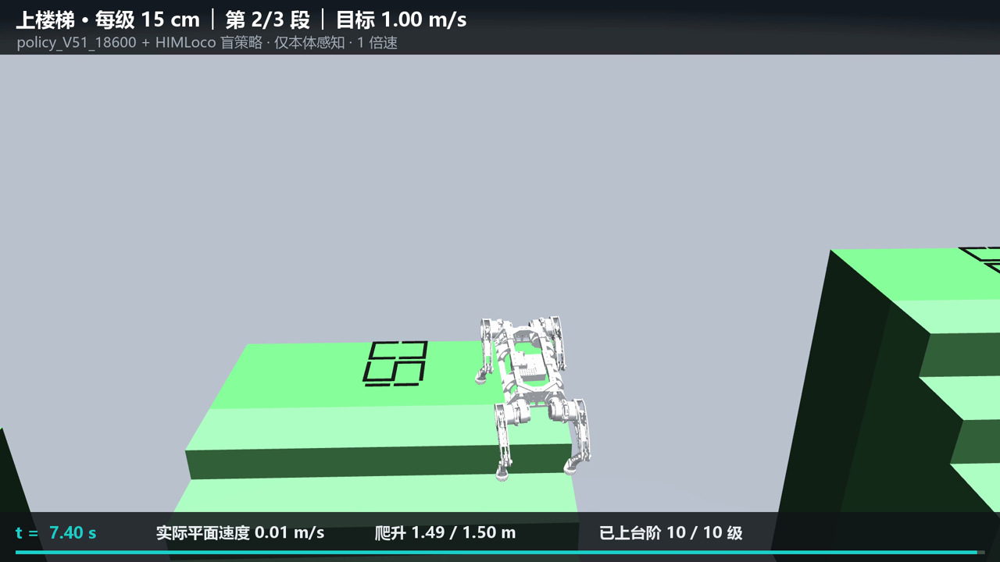

# HIMLoco_LGDog

<div align="center">


### 把 [HIMLoco](https://github.com/OpenRobotLab/HIMLoco) 的**盲跑**四足运动控制，落到自研四足 **LgDog1** 上
训练 → 导出 TorchScript → MuJoCo sim2sim → 实机部署，全流程可复现

<sub>MIT License · 盲策略（纯本体感知，无视觉）</sub>

</div>

---

## 演示：15 cm 台阶，纯本体感知，1.0 m/s 登顶

<div align="center">

</div>

每级 15 cm × 10 级（踏面 30 cm、车道宽 1.6 m），顶部平台 1.5 m。
指令 1.0 m/s（这份策略的训练上限），**没有任何视觉/感知输入**——观测里只有指令、角速度、重力向量、关节角、关节角速度、上一步动作，共 45×6 = 270 维。

| | |
|---|---|
| 完整视频（1080p / 25fps / 1 倍速） | [`media/blinddog_stairs15cm_1p0ms_1080p.mp4`](media/blinddog_stairs15cm_1p0ms_1080p.mp4) |
| 爬到一半 |  |
| 站上 1.5 m 平台 |  |

### 同一份策略在三条车道上的实测（MuJoCo sim2sim，每级 10 级全上）

| 车道 | 每级高度 | 顶部平台 | 指令速度 | 结果 | 用时 |
|---|---|---|---|---|---|
| y = +1.0 | 10 cm | 1.0 m | 1.0 m/s | 10/10 级，站稳 | 8.0 s |
| y = −2.0 | **15 cm** | 1.5 m | 1.0 m/s | 10/10 级，站稳 | 8.6 s |
| y = −5.0 | 20 cm | 2.0 m | 0.9 m/s | 10/10 级，站稳 | 15.2 s |

同样的三条在 0.6 m/s 下也都能登顶（更稳、更慢）。20 cm 到 1.0 m/s 就上不去了——实测把横向指令从 0 扫到 0.12，最好也只到第 5~6 级，降到 0.9 m/s 才行。

---

## 这是什么

上游 [HIMLoco](https://github.com/OpenRobotLab/HIMLoco)（ICLR 2024，Hybrid Internal Model）是面向宇树 A1/Go1 的盲跑运动控制框架。本仓库把它移植到自研四足 **LgDog1**（12 自由度），并补齐了从训练到实机的一整套工程：

- **训练**：`legged_gym` + `rsl_rl`（均为 HIMLoco 改过的 fork），Isaac Gym Preview 4；地形是程序化 trimesh，含 6 类子地形（斜坡 / 起伏 / 上楼 / 下楼 / 随机障碍 / 等高台障碍带）+ 越障课程。
- **奖励塑形**：在 HIMLoco 基础项之上，参考 **OpenDoge** 的奖励设计补了 `default_pos_linear`、`diagonal_sync`、`hip_mirror_symmetry` 等步态项，并把 `base_height`、`feet_air_time`、`stand_still` 的表单对齐到 OpenDoge 的形式（细节见下方「来源与致谢」）。
- **调参体系**：51 轮迭代（V1 → V51），每一轮的配置快照、改动理由、预期判据、实测结果都落在 [`tuning_log.json`](tuning_log.json)，工作流见 [`AGENT.md`](AGENT.md)。
- **导出策略**：[`legged_gym/logs/flat_LgDog1/exported/policies/`](legged_gym/logs/flat_LgDog1/exported/policies) 下的 TorchScript（973 KB，含观测归一化统计）。
- **sim2sim**：[`legged_gym/legged_gym/scripts/sim2sim.py`](legged_gym/legged_gym/scripts/sim2sim.py)，MuJoCo 里跑同一份策略，带键盘/手柄、策略 IO 录制、以及与训练快照的保真度对齐。
- **实机部署**：[`deploy/sim2real/`](deploy/sim2real)，策略运行器 + HostLink 后端 + 安全层。
- **出片工具**：[`tools/render_stairs.py`](tools/render_stairs.py) 离屏渲染 + HUD 成片；[`tools/eval_stairs.py`](tools/eval_stairs.py) 只跑不渲染、量化爬升。

### 策略契约（必须与训练一致，否则 OOD 必挂）

| 项 | 值 |
|---|---|
| 观测 | 45 维 × 6 帧历史 = 270 维（指令3 + 角速度3 + 重力向量3 + 关节角12 + 关节角速度12 + 上一动作12） |
| 动作 | 12 维关节位置增量，`action_scale = 0.25` |
| 控制频率 | 物理 200 Hz，`decimation = 4` → **50 Hz** |
| PD | `kp = 40`、`kd = 1.2` |
| 指令范围 | `lin_vel_x/y ∈ [−1.0, 1.0] m/s`（训练上限就是 1.0） |

---

## 快速开始

### 1. sim2sim（只需要 CPU）

```bash
# 依赖：python 3.10+ / mujoco>=3.0 / torch(cpu) / numpy / imageio+imageio-ffmpeg（出片才要）
cd legged_gym/legged_gym/scripts

python sim2sim.py --no-render --no-keyboard --gamepad off \
  --scene ../resources/robots/LgDog1/xml/scene.xml \
  --policy ../../logs/flat_LgDog1/exported/policies/policy_V51_18600.pt \
  --snapshot ../../logs/flat_LgDog1/Oct14_10-28-45_LgDog1_himloco/config_snapshot.json \
  --spawn-y -2.0 --x_vel 1.0 --friction 1.0
```

带上 `--spawn-y` 就是对准某条车道（+4.0 / +1.0 / −2.0 / −5.0 分别是 5 / 10 / 15 / 20 cm），
`--friction 1.0` 对齐训练摩擦（MuJoCo 模型原值是 0.6，用 0.6 会在第一级就绊倒）。

### 2. 只量爬升，不看画面

```bash
python tools/eval_stairs.py --lane -2.0 --step-h 0.15 --cmd 1.0 --secs 16
# → RESULT {... "steps_climbed": 10.6, "x_max": 4.16, "upright_end": true}
```

### 3. 出片（1080p，带 HUD）

```bash
python tools/render_stairs.py --lane -2.0 --step-h 0.15 --label 15 --plat-h 1.5 \
  --cmd 1.0 --idx 2 --total 3 --out 上楼梯_15cm.mp4
```

画面：第三人称追尾视角 + 顶部任务条 + 底部（时间 / 实际平面速度 / 爬升 / 已上台阶）+ 青色进度条；
到顶后自动收指令并缓慢环绕停住，不会冲出平台掉下去。

### 4. 训练（需要 Isaac Gym）

按上游说明装 Isaac Gym Preview 4 后：

```bash
cd legged_gym/legged_gym/scripts
python train.py --task LgDog1 --headless --num_envs 4096
python play.py --task LgDog1        # 导出最新策略到 exported/policies/policy.pt
```

---

## 两个必须知道的坑

1. **直行漂移**。这份策略开环直行会画弧（训练时偏航由环境的朝向控制器闭合，见 `sim2sim.py` 的「朝向保持层」）。跑楼梯这种长距离直线时，可以在横向指令上补一点（10 cm 道 −0.04、15 cm 道 0、20 cm 道 +0.06 m/s），相当于打杆微调；不补的话 20 cm 那条会在第 8 级漂出 1.6 m 宽的车道。
2. **sim2sim ≠ Isaac**。MuJoCo 没有关节速度上限、没有去穿模速度限制，摩擦默认 0.6。所以台阶测试要 `--friction 1.0 --clamp-vel`，否则看到的是仿真伪影（历史上 10 cm 台阶被弹到 1.8 m 高就是这么来的）。

---

## 仓库结构

```
HIMLoco_LGDog
├── legged_gym/                     训练环境（Isaac Gym）+ 机器人资源
│   ├── legged_gym/
│   │   ├── envs/
│   │   │   ├── base/legged_robot.py      环境基类：观测/奖励/课程/地形采样（HIMLoco 改过）
│   │   │   └── LgDog1/LgDog1_config.py   本机器人全部超参：PD、指令范围、奖励权重、地形比例
│   │   ├── scripts/
│   │   │   ├── train.py                 训练入口
│   │   │   ├── play.py                  回放 + 导出 TorchScript 策略
│   │   │   ├── sim2sim.py               ★ MuJoCo 里跑同一份策略（本仓库的工作马）
│   │   │   ├── urdf2xml.py              URDF → MJCF 转换
│   │   │   ├── check_model.py           模型/关节/限位体检
│   │   │   └── measure_stand.py         站高与被动姿态测量
│   │   └── utils/terrain.py             程序化 trimesh 地形（坡/上下楼/障碍带/高台）
│   ├── resources/robots/LgDog1/
│   │   ├── urdf/LgDog1.urdf             机器人本体定义（12 自由度）
│   │   ├── xml/LgDog1.xml               转换出的 MJCF
│   │   ├── xml/scene.xml                ★ 测试地图：四组楼梯(5/10/15/20cm) + 五个高台
│   │   └── meshes/*.STL                机身与连杆网格
│   └── logs/flat_LgDog1/
│       ├── exported/policies/           ★ 导出策略（policy.pt / policy_V51_18600.pt）
│       └── V*/ 、 Oct*/                 每轮训练的 config_snapshot.json（完整配置快照）
├── rsl_rl/                         PPO 与 HIM-PPO（含 him_estimator / him_actor_critic）
├── deploy/sim2real/                实机部署
│   ├── main.py                          策略运行主循环
│   ├── config.yaml / hardware_map.yaml  机器人、总线、关节映射
│   ├── backends/host_link_backend.py    与下位机的通信后端
│   ├── interface/ 、 safety/ 、 startup/ 观测适配、安全层、启动脚本
│   └── models/policy.pt                 上机策略 + policy.json（契约）
├── tools/                          脚本工具箱
│   ├── eval_stairs.py                   ★ 楼梯能力量化（不渲染，出 JSON）
│   ├── render_stairs.py                 ★ 1080p 出片 + HUD
│   ├── tuning_log.py                    调参日志增删改查 / 快照 diff
│   ├── check_config.py                  配置体检（重复赋值、权重↔函数配对）
│   ├── check_criteria.py                各轮验收判据与阈值
│   ├── make_policy_sidecar.py           从快照生成策略契约 json
│   ├── use_policy.sh                   切换 policy.pt 指向哪个导出
│   ├── foot_reach.py / foot_audit.py    抬腿可达包线、摆动净空审计
│   ├── mj_stand_report.py / analyze_attitude.py   sim2sim 录制的姿态与站高报告
│   └── launch_train.sh / train_watchdog.sh / queue_next_run.sh   训练编排
├── logs/                           早期调参存档 + V1 配置模板（_config_v1）
├── media/                          演示视频、GIF、截图、战队 logo
├── docs/                           上游 README 存档 + 上游许可原文
├── projects/                       HIMLoco / H-Infinity 论文项目页
├── AGENT.md                        ★ 调参工作流：三层记录体系（快照/日志/报告）
├── tuning_log.json                 ★ 51 轮迭代的完整实验记录（本仓库信息量最大的文件）
└── requirements.txt
```

### 几个关键文件怎么用

| 想做什么 | 看这里 |
|---|---|
| 改机器人参数（站高、限位、PD、指令范围） | `legged_gym/legged_gym/envs/LgDog1/LgDog1_config.py` |
| 改奖励函数 | `legged_gym/legged_gym/envs/base/legged_robot.py`（`_reward_*` 一族） |
| 改地形（楼梯高度、障碍带宽度） | `legged_gym/legged_gym/utils/terrain.py` + 配置里的 `terrain.*` |
| 在 MuJoCo 里复现某个策略 | `legged_gym/legged_gym/scripts/sim2sim.py` |
| 量「能上多高的台阶」 | `tools/eval_stairs.py`（输出 JSON，可批量扫） |
| 出一段能发出去的片子 | `tools/render_stairs.py` |
| 查「为什么当初这么改」 | `tuning_log.json` + `AGENT.md` |

> 仓库里**不含**训练 checkpoint（`model_*.pt`，单份 6.3 MB × 1300+）、TensorBoard 事件（~490 MB）和部署用的 Python 虚拟环境——它们只在训练机上。要复现请自己训或找作者要。

---

## 来源与致谢

这个仓库站在四个项目上，感谢作者们把东西开源出来：

| 项目 | 提供了什么 | 许可 |
|---|---|---|
| [OpenRobotLab/HIMLoco](https://github.com/OpenRobotLab/HIMLoco) | 整体框架：HIM 估计器、HIM-PPO、`legged_gym`/`rsl_rl` 改造、训练地形与课程 | CC BY-NC-SA 4.0 |
| [OpenDogeRobotics/OpenDoge_train](https://github.com/OpenDogeRobotics/OpenDoge_train) | **奖励函数设计参考**（见下） | Apache-2.0 |
| [leggedrobotics/legged_gym](https://github.com/leggedrobotics/legged_gym) | 训练环境骨架 | BSD-3-Clause |
| [leggedrobotics/rsl_rl](https://github.com/leggedrobotics/rsl_rl) | PPO 实现骨架 | BSD-3-Clause |

### 奖励函数里哪些是 OpenDoge 的

HIMLoco 自带的接触/跟踪/姿态那套保留，**步态塑形部分参考 OpenDoge 重做**（`tools/add_opendoge_rewards.py` 有完整移植记录，函数体逐字取自 `OpenDoge_train/legged_gym/envs/base/legged_robot.py`）：

- **新增三项**：`default_pos_linear`（12 关节偏离默认位的 L1，梯度恒定）、`diagonal_sync`（trot 对角触地同步）、`hip_mirror_symmetry`（髋左右镜像）
- **表单对齐**：`base_height` 改成 `((h − target) × 10)²`（比普通平方陡 100 倍）、`feet_air_time` 用它的 >0.3 s 门控、`stand_still` 用 `‖cmd‖ < 0.4` 门控
- **另有三项接入但权重 0**：`feet_contact_forces` / `feet_parallel_to_ground` / `hip_joint_pos`（OpenDoge 只写了实现没配权重，这里同样默认关闭）

⚠️ 一个实测教训也记在这：把 OpenDoge 的奖励**整套**照搬到 trimesh 地形上，会训出「原地站着不动」的退化解（V23 轮，见 `tuning_log.json`）——它的奖励设计依赖它自己的平地设定，不能只搬奖励。

---

## 许可

本仓库**自行编写**的部分（LgDog1 适配与配置、`deploy/` 部署栈、sim2sim 增强、`tools/eval_stairs.py`、`tools/render_stairs.py`、调参体系与全部文档）以 **MIT** 发布，见 [LICENSE](LICENSE)。逐项范围见 [`docs/NOTICE_许可范围.md`](docs/NOTICE_许可范围.md)。

继承自上游的文件保留各自原始许可，不被 MIT 覆盖：

- `legged_gym/` 中来自 HIMLoco 的部分 — CC BY-NC-SA 4.0（原文存档：[`docs/LICENSE_HIMLoco_CC-BY-NC-SA.txt`](docs/LICENSE_HIMLoco_CC-BY-NC-SA.txt)）
- `legged_gym/LICENSE`、`rsl_rl/LICENSE` — BSD-3-Clause
- 参考自 OpenDoge_train 的奖励函数实现 — Apache-2.0

换句话说：**用 `deploy/`、`tools/` 和本文档做自己的项目没问题（MIT）；如果你想拿整套训练代码去做商业产品，HIMLoco 那部分的非商用条款仍然约束着你。**

## 引用

```bibtex
@inproceedings{long2023him,
  title={Hybrid Internal Model: Learning Agile Legged Locomotion with Simulated Robot Response},
  author={Long, Junfeng and Wang, ZiRui and Li, Quanyi and Cao, Liu and Gao, Jiawei and Pang, Jiangmiao},
  booktitle={The Twelfth International Conference on Learning Representations},
  year={2024}
}
```

<div align="center">
<sub>漓光战队 · 自研四足 LgDog1 · 盲跑运动控制</sub>
</div>
