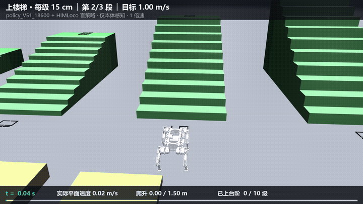
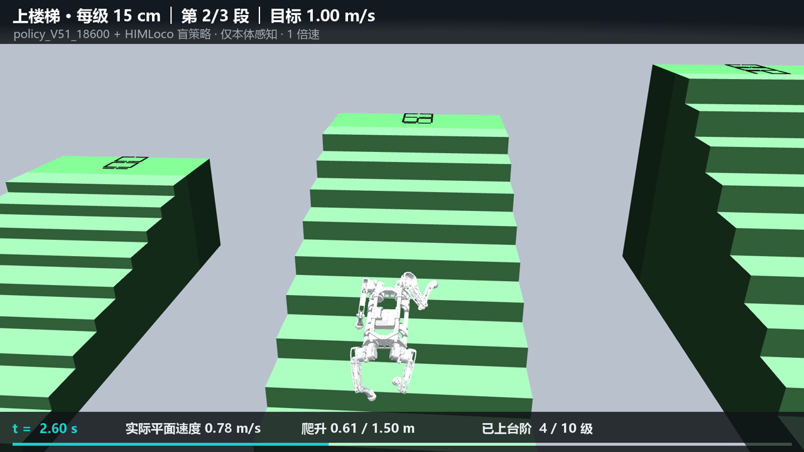

# HIMLoco_LGDog

<div align="center">


### 把 [HIMLoco](https://github.com/OpenRobotLab/HIMLoco) 的**盲跑**四足运动控制，落到自研四足 **LgDog1** 上
训练 → 导出 TorchScript → MuJoCo sim2sim → 实机部署，全流程可复现

</div>

---

## 演示：15 cm 台阶，纯本体感知，1.0 m/s 登顶

<div align="center">

</div>

每级 15 cm × 10 级（踏面 30 cm、车道宽 1.6 m），顶部平台 1.5 m。
指令 1.0 m/s（这份策略的训练上限），**没有任何视觉/感知输入**——观测里只有指令、角速度、重力向量、关节角、关节角速度、上一步动作，共 45×6 = 270 维。

| | |
|---|---|
| 完整视频（1080p / 25fps / 1 倍速） | [`media/blinddog_stairs15cm_1p0ms_1080p.mp4`](media/blinddog_stairs15cm_1p0ms_1080p.mp4) |
| 爬到一半 |  |
| 站上 1.5 m 平台 |  |

### 同一份策略在三条车道上的实测（MuJoCo sim2sim，每级 10 级全上）

| 车道 | 每级高度 | 顶部平台 | 指令速度 | 结果 | 用时 |
|---|---|---|---|---|---|
| y = +1.0 | 10 cm | 1.0 m | 1.0 m/s | 10/10 级，站稳 | 8.0 s |
| y = −2.0 | **15 cm** | 1.5 m | 1.0 m/s | 10/10 级，站稳 | 8.6 s |
| y = −5.0 | 20 cm | 2.0 m | 0.9 m/s | 10/10 级，站稳 | 15.2 s |

同样的三条在 0.6 m/s 下也都能登顶（更稳、更慢）。20 cm 到 1.0 m/s 就上不去了——实测把横向指令从 0 扫到 0.12，最好也只到第 5~6 级，降到 0.9 m/s 才行。

---

## 这是什么

上游 [HIMLoco](https://github.com/OpenRobotLab/HIMLoco)（ICLR 2024，Hybrid Internal Model）是面向宇树 A1/Go1 的盲跑运动控制框架。本仓库把它移植到自研四足 **LgDog1**（12 自由度），并补齐了从训练到实机的一整套工程：

- **训练**：`legged_gym` + `rsl_rl`（均为 HIMLoco 改过的 fork），Isaac Gym Preview 4；地形是程序化 trimesh，含 6 类子地形（斜坡 / 起伏 / 上楼 / 下楼 / 随机障碍 / 等高台障碍带）+ 越障课程。
- **调参体系**：51 轮迭代（V1 → V51），每一轮的配置快照、改动理由、预期判据、实测结果都落在 [`tuning_log.json`](tuning_log.json)，工作流见 [`AGENT.md`](AGENT.md)。
- **导出策略**：[`legged_gym/logs/flat_LgDog1/exported/policies/`](legged_gym/logs/flat_LgDog1/exported/policies) 下的 TorchScript（973 KB，含观测归一化统计）。
- **sim2sim**：[`legged_gym/legged_gym/scripts/sim2sim.py`](legged_gym/legged_gym/scripts/sim2sim.py)，MuJoCo 里跑同一份策略，带键盘/手柄、策略 IO 录制、以及与训练快照的保真度对齐。
- **实机部署**：[`deploy/sim2real/`](deploy/sim2real)，策略运行器 + HostLink 后端 + 安全层。
- **出片工具**（本仓库新增）：[`tools/render_stairs.py`](tools/render_stairs.py) 离屏渲染 + 参考视频同款 HUD；[`tools/eval_stairs.py`](tools/eval_stairs.py) 只跑不渲染、量化爬升。

### 策略契约（必须与训练一致，否则 OOD 必挂）

| 项 | 值 |
|---|---|
| 观测 | 45 维 × 6 帧历史 = 270 维（指令3 + 角速度3 + 重力向量3 + 关节角12 + 关节角速度12 + 上一动作12） |
| 动作 | 12 维关节位置增量，`action_scale = 0.25` |
| 控制频率 | 物理 200 Hz，`decimation = 4` → **50 Hz** |
| PD | `kp = 40`、`kd = 1.2` |
| 指令范围 | `lin_vel_x/y ∈ [−1.0, 1.0] m/s`（训练上限就是 1.0） |

---

## 快速开始

### 1. sim2sim（只需要 CPU）

```bash
# 依赖：python 3.10+ / mujoco>=3.0 / torch(cpu) / numpy / imageio+imageio-ffmpeg（出片才要）
cd legged_gym/legged_gym/scripts

python sim2sim.py --no-render --no-keyboard --gamepad off \
  --scene ../resources/robots/LgDog1/xml/scene.xml \
  --policy ../../logs/flat_LgDog1/exported/policies/policy_V51_18600.pt \
  --snapshot ../../logs/flat_LgDog1/Oct14_10-28-45_LgDog1_himloco/config_snapshot.json \
  --spawn-y -2.0 --x_vel 1.0 --friction 1.0
```

带上 `--spawn-y` 就是对准某条车道（+4.0 / +1.0 / −2.0 / −5.0 分别是 5 / 10 / 15 / 20 cm），
`--friction 1.0` 对齐训练摩擦（MuJoCo 模型原值是 0.6，用 0.6 会在第一级就绊倒）。

### 2. 只量爬升，不看画面

```bash
python tools/eval_stairs.py --lane -2.0 --step-h 0.15 --cmd 1.0 --secs 16
# → RESULT {... "steps_climbed": 10.6, "x_max": 4.16, "upright_end": true}
```

### 3. 出片（1080p，带 HUD）

```bash
python tools/render_stairs.py --lane -2.0 --step-h 0.15 --label 15 --plat-h 1.5 \
  --cmd 1.0 --idx 2 --total 3 --out 上楼梯_15cm.mp4
```

画面：第三人称追尾视角 + 顶部任务条 + 底部（时间 / 实际平面速度 / 爬升 / 已上台阶）+ 青色进度条；
到顶后自动收指令并缓慢环绕停住，不会冲出平台掉下去。

### 4. 训练（需要 Isaac Gym）

按上游说明装 Isaac Gym Preview 4 后：

```bash
cd legged_gym/legged_gym/scripts
python train.py --task LgDog1 --headless --num_envs 4096
python play.py --task LgDog1        # 导出最新策略到 exported/policies/policy.pt
```

---

## 两个必须知道的坑

1. **直行漂移**。这份策略开环直行会画弧（训练时偏航由环境的朝向控制器闭合，见 `sim2sim.py` 的「朝向保持层」）。跑楼梯这种长距离直线时，可以在横向指令上补一点（10 cm 道 −0.04、15 cm 道 0、20 cm 道 +0.06 m/s），相当于打杆微调；不补的话 20 cm 那条会在第 8 级漂出 1.6 m 宽的车道。
2. **sim2sim ≠ Isaac**。MuJoCo 没有关节速度上限、没有去穿模速度限制，摩擦默认 0.6。所以台阶测试要 `--friction 1.0 --clamp-vel`，否则看到的是仿真伪影（历史上 10 cm 台阶被弹到 1.8 m 高就是这么来的）。

---

## 目录

```
legged_gym/          # 训练环境（Isaac Gym）+ 资源（URDF/MJCF/网格）
  legged_gym/scripts/sim2sim.py     # MuJoCo 策略验证
  legged_gym/envs/LgDog1/           # 机器人配置与任务
  resources/robots/LgDog1/xml/      # scene.xml = 四组楼梯 + 五个高台的测试地图
  logs/flat_LgDog1/exported/policies/  # 导出的 TorchScript 策略
rsl_rl/              # PPO / HIM-PPO（HIMLoco fork）
deploy/sim2real/     # 实机部署：策略运行器、HostLink、安全层
tools/               # 调参日志、报告、画图、以及本仓库新增的楼梯评测/出片脚本
media/               # 演示视频与截图
tuning_log.json      # 51 轮迭代的完整调参记录（本仓库最有信息量的文件）
AGENT.md             # 调参工作流（三层记录体系）
docs/                # 上游 HIMLoco README 存档
```

> 仓库里**不含**训练 checkpoint（`model_*.pt`，单份 6.3 MB × 1300+）、TensorBoard 事件（~490 MB）和部署用的 Python 虚拟环境——它们只在训练机上。要复现请自己训或找作者要。

---

## 引用与许可

本项目建立在以下工作之上：

```bibtex
@inproceedings{long2023him,
  title={Hybrid Internal Model: Learning Agile Legged Locomotion with Simulated Robot Response},
  author={Long, Junfeng and Wang, ZiRui and Li, Quanyi and Cao, Liu and Gao, Jiawei and Pang, Jiangmiao},
  booktitle={The Twelfth International Conference on Learning Representations},
  year={2024}
}
```

- 上游代码：[OpenRobotLab/HIMLoco](https://github.com/OpenRobotLab/HIMLoco)，[legged_gym](https://github.com/leggedrobotics/legged_gym)、[rsl_rl](https://github.com/leggedrobotics/rsl_rl)
- 许可：沿用上游 **CC BY-NC-SA 4.0**（署名—非商业性使用—相同方式共享），详见 [LICENSE](LICENSE)

<div align="center">
<sub>漓光战队 · 自研四足 LgDog1 · 盲跑运动控制</sub>
</div>
